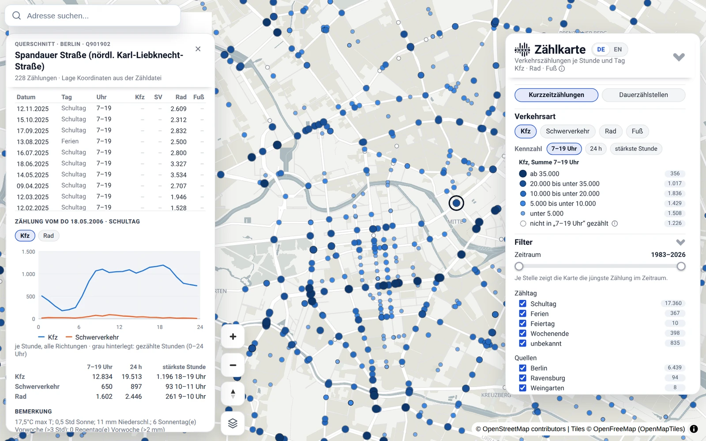

<picture>
  <source media="(prefers-color-scheme: dark)" srcset="public/logo/zaehlkarte-signet-weiss.svg">
  
</picture>

# Zählkarte – Verkehrszählungen je Stunde und Tag

Städte zählen ständig Verkehr: an Kreuzungen und Straßenabschnitten, von Hand, per Video oder mit
fest eingebauten Zählern. Die Ergebnisse liegen meist in Schubladen. Die Zählkarte sammelt, was
offen ist oder per Informationsfreiheitsanfrage herausgegeben wurde, und zeigt die Zählwerte je
Verkehrsart auf einer Karte.

**[Zur Karte →](https://vizsim-lab.github.io/zaehlkarte/)**

## Was die Karte zeigt

- **Kurzzeitzählungen** an Kreuzungen und Straßenabschnitten: Kfz, Schwerverkehr, Rad und Fuß –
  als Summe 7–19 Uhr, über 24 Stunden oder als stärkste Stunde, mit dem Tagesgang jeder Zählung.
- **Dauerzählstellen**: fest eingebaute Zähler mit Tagessummen über Jahre und Stundenwerten –
  Detektoren in Berlin, Wärmebildkameras in Hamburg, die Zählstellen des Landes
  Baden-Württemberg, Rad-Zählstellen vieler Städte und Passantenzählungen.
- **Steckbrief je Kommune** (Klick auf ihren Punkt): was es dort gibt – je Familie und
  Verkehrsart mit Zeitraum und Umfang –, dazu die Datenlage: wo es solche Zählungen offen gibt, wo
  sie auf Anfrage herausgegeben wurden und wo eine Anfrage aussichtsreich ist, mit Belegen.
- **CSV-Download** (nur Quellen mit Lizenz), Oberfläche auf Deutsch und Englisch.

Nur gezählte Werte je Stunde oder je Tag an einer bestimmten Stelle, gleich, wer zählt.
Jahresmittel (DTV), Verkehrsmengenkarten und Modellwerte stehen in
[vizsim/svz](https://github.com/vizsim/svz).

## Mehr dazu

- [Quellen](docs/QUELLEN.md): alle Quellen mit Zeitraum, Weg und Lizenz
- [Was die Karte zeigt](docs/KARTE.md): Kennzahlen, Dauerzählstellen und die Eigenheiten jeder Quelle
- [Datenlage](docs/DATENLAGE.md): je Kommune, was es gibt und wo eine Anfrage aussichtsreich ist
- [Entwicklung](docs/ENTWICKLUNG.md): Aufbau, Pipeline, Karte und Workflows
- [Logo](docs/LOGO.md)

## Mitmachen

Fehlen Zählungen einer Kommune? Gern über das Formular
[„Zählungen melden“](https://github.com/vizsim-lab/zaehlkarte/issues/new?template=zaehlung-melden.yml).

## Lizenz

- **Code:** AGPL-3.0-or-later. ZDA-Leser und Namensbereinigung stammen aus
  [vizsim/berlin-traffic-counts_schulwege](https://github.com/vizsim/berlin-traffic-counts_schulwege) (MIT).
- **Daten:** die Lizenz der jeweiligen Quelle (in der Karte je Zählung und je Dauerzählstelle, im
  CSV-Export in jeder Zeile); Namensnennung erforderlich. Quellen ohne Lizenz zeigt die Karte mit
  Hinweis und Link zum Original, nie im CSV-Export; Rechteinhaber können sie über das Formular
  [„Daten entfernen lassen“](https://github.com/vizsim-lab/zaehlkarte/issues/new?template=daten-entfernen.yml)
  entfernen lassen ([Einzelheiten](docs/QUELLEN.md#quellen-ohne-lizenz)).
- Hintergrundkarte © OpenStreetMap-Mitwirkende, OpenFreeMap; Relief: Mapterhorn.
